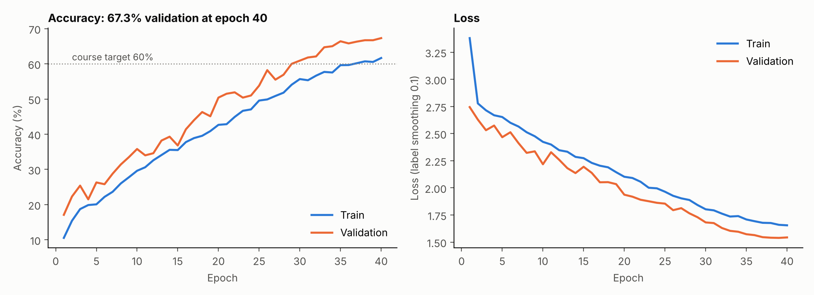
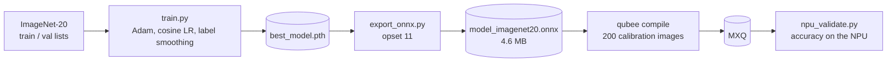
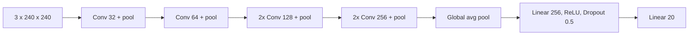

# ImageNet-20 CNN from scratch, exported for the Mobilint NPU

A 1.2M-parameter convolutional network trained from scratch (no pretrained weights) to classify 20 ImageNet classes at 240x240, then exported to ONNX (opset 11) for compilation to an NPU executable. Lab 1 of DATA 255 (Deep Learning), San José State University.

| | Value |
|---|---|
| Classes | 20 |
| Data | 6,000 training images (300 per class), 1,000 validation images |
| Parameters | 1,197,876 |
| Best validation accuracy | **67.3%** (epoch 40, FP32 PyTorch) |
| Final training accuracy | 61.65% (with augmentation and label smoothing) |
| Course target | 60% or more |
| GPU | Tesla T4 |

Validation accuracy ends above training accuracy because training uses heavy augmentation (random crops, rotation, color jitter), label smoothing and dropout, while validation does not.

## Pipeline

## Architecture

Each conv is 3x3 without bias, followed by batch norm and ReLU; weights use Kaiming initialization.

## Training setup

| Setting | Value |
|---|---|
| Optimizer | Adam, lr 1.5e-3, weight decay 1e-4 |
| Schedule | Cosine annealing to 1e-6 over 40 epochs |
| Loss | Cross-entropy, label smoothing 0.1 |
| Batch size | 64 |
| Augmentation | RandomResizedCrop (0.6 to 1.0), flip, color jitter, rotation 15 degrees |

`results/training_log.csv` is the per-epoch log from the run.

## Files

| File | Purpose |
|---|---|
| `model.py` | Network definition (run it to print the parameter count) |
| `train.py` | Training loop and data loading from the list files |
| `export_onnx.py` | ONNX export and ONNX Runtime check |
| `npu_validate.py` | Accuracy check of the compiled MXQ on a Mobilint NPU |
| `make_chart.py` | Redraws the chart from the log |

## Notes

- The NPU accuracy of the compiled model is not recorded in this repository, so only the FP32 result is reported.
- `npu_validate.py` needs the Mobilint `maccel` runtime and an NPU.
- The dataset is not included.

## Notebooks

| Notebook | Contents |
|---|---|
| [`Lab1_Working.ipynb`](notebooks/Lab1_Working.ipynb) | The run this repository documents (best validation accuracy 67.30%) |
| [`experiments/Lab1_ImageNet20_residual_net.ipynb`](notebooks/experiments/Lab1_ImageNet20_residual_net.ipynb) | Residual-block variant, 30 epochs, best validation accuracy 66.20% |
| [`experiments/Lab1_DualPathNet20.ipynb`](notebooks/experiments/Lab1_DualPathNet20.ipynb) | Larger SE / inverted-residual network (3,506,836 parameters), best validation accuracy 70.70% |
| `experiments/Lab1_early_version*.ipynb` | Earlier drafts, kept for reference |
| `npu_helpers/` | Notebooks for the ONNX-to-MXQ conversion, calibration images and NPU validation (no saved outputs) |

The 70.70% run is a different, larger model than the one documented above. Its validation accuracy swung between about 58% and 71% from epoch to epoch under a warm-restart schedule, and it did not print an NPU or ONNX accuracy, so the NPU accuracy of the compiled model remains unrecorded for every variant.

Student identifiers and Colab account metadata were removed; code and outputs are unchanged.

